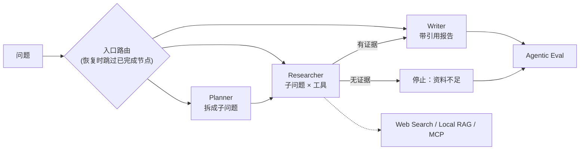

# LangGraph MCP Research Agent

[](https://github.com/liuyusheng-ai/langgraph-mcp-research-agent/actions/workflows/ci.yml)

面向行业调研场景的多智能体研究 Agent。LangGraph 编排 Planner、Researcher、Writer 三个角色：先拆解问题，再按子问题调用网页搜索、本地 RAG 和 MCP 工具收集证据，最后生成带编号引用的报告。

重点不在“能生成报告”，而在**工具出错时 Agent 怎么停**：调用预算、重复调用拦截、超时与重试、无证据停止生成、断点恢复，每一条都有测试和可复现评测。

## 评测结果

`python eval/run_eval.py` 离线运行（网页搜索用演示资料，MCP 走仓库自带的 stdio 服务，不调用大模型），完整明细见 [eval/RESULTS.md](eval/RESULTS.md)。

| 指标 | 结果 |
| --- | --- |
| 研究任务通过 | 15/15（12 个可回答 + 3 个无资料问题） |
| 可回答任务完成率 / 引用覆盖率 | 100% / 100% |
| 工具调用成功率 | 100% |
| 有效工具结果率（返回了至少 1 条证据） | 74.65% |
| 无资料问题正确停止生成 | 3/3 |
| Harness 故障场景通过 | 8/8 |
| 单任务延迟 P50 / P95 | 约 348 ms / 435 ms（主要是 MCP 子进程启动） |

这些是确定性离线结果，用来证明控制逻辑正确；不代表接入真实网页搜索或大模型后的研究质量。

## 架构



每个节点结束都写入 SQLite 检查点；进程中断后用同一个 `run_id` 加 `--resume` 继续，已执行的工具调用不会重复执行。

## Harness 规则

| 规则 | 行为 |
| --- | --- |
| 调用预算 | 默认 8 次；用完记录 `budget_exhausted` 并停止检索 |
| 重复调用 | 同一工具 + 规范化后相同的子问题，记 `loop_blocked`，不执行、不扣预算 |
| 超时 | 单次调用默认 5 秒，超时记 `timeout` |
| 重试 | 只重试超时和临时错误（网络、429/5xx）；参数错误等永久错误立即返回，不浪费预算 |
| 未配置工具 | 记 `not_configured`，不计入调用成功率，避免“空跑也算成功” |
| 空结果 | 记 `empty`：调用成功但没有证据，单独计入有效结果率 |
| 无证据 | 不进入 Writer，直接输出“资料不足”，不生成结论 |

评测里的调用成功率只统计真正执行了的调用；被 Harness 拦下的调用单独计数。

## 快速开始

需要 Python 3.10+。

```bash
python -m venv .venv
source .venv/bin/activate          # Windows: .venv\Scripts\activate
pip install -r requirements.txt

python cli.py "LangGraph、RAG 与 MCP 在企业 Agent 中如何协作"
python cli.py "MCP 服务的权限与脱敏怎么设计" --demo-mcp   # 同时连接本地 stdio MCP 服务
python cli.py "原问题" --run-id <RUN_ID> --resume            # 从检查点继续
```

默认不需要任何 API Key。设置 `TAVILY_API_KEY` 后网页搜索走真实接口，Agent 主流程不变。

## MCP 接入

`research_agent/mcp_client.py` 基于官方 MCP Python SDK 连接 stdio 服务：调用前先 `list_tools` 确认工具存在，整次调用有超时，服务端返回 `isError` 时转成永久错误。`examples/demo_mcp_server.py` 是一个用 FastMCP 写的最小服务，测试和评测都通过它做真实的进程间往返。

```python
from research_agent.mcp_client import MCPClient, MCPServerConfig
from research_agent.tools import ResearchToolbox

client = MCPClient(MCPServerConfig(command="python", args=["your_mcp_server.py"]))
toolbox = ResearchToolbox.default(mcp_client=client)
```

生产环境还应为 MCP 服务配置独立权限、参数白名单和返回内容脱敏。

## 测试

```bash
pytest -q                 # 18 项：Harness 各规则、断点恢复、评测口径、3 项真实 MCP 往返
python eval/run_eval.py   # 15 个研究任务 + 8 个故障场景
```

CI 在 Python 3.10 / 3.11 / 3.12 上运行全部测试和评测。

## 目录

```text
research_agent/
  agent.py         LangGraph 图、入口路由、Researcher Harness
  tools.py         Web / 本地 RAG / MCP 工具，统一 Evidence 输出
  mcp_client.py    官方 MCP SDK 客户端
  checkpoint.py    SQLite 检查点
  evaluation.py    任务完成、调用成功率、有效结果率、引用覆盖
  llm.py           可替换的规划与写作模型（离线实现）
examples/demo_mcp_server.py   本地 stdio MCP 服务
eval/                         评测场景、运行脚本与结果
tests/                        自动化测试
cli.py                        命令行入口
```

## 局限

- `llm.py` 是确定性的离线实现，用来让控制逻辑可测；接入真实模型只需替换 `plan` 和 `write_report`。
- 本地 RAG 是关键词（中文二元组）匹配的演示检索，不是向量检索。
- 每次 MCP 调用都会新建一个 stdio 会话，简单可靠，但有几百毫秒的启动开销；高频调用应复用会话。
